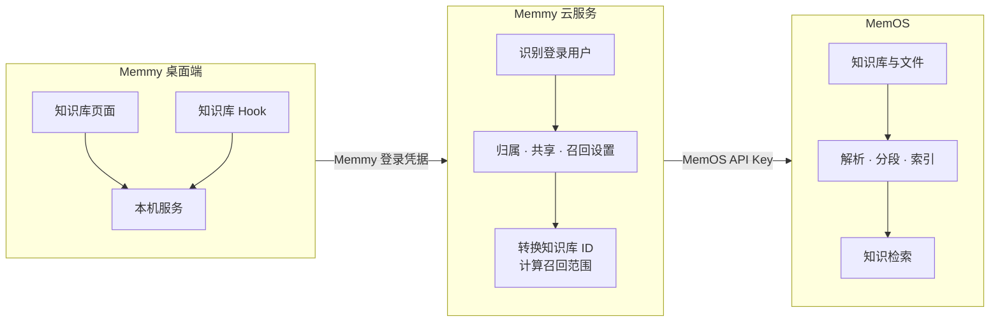
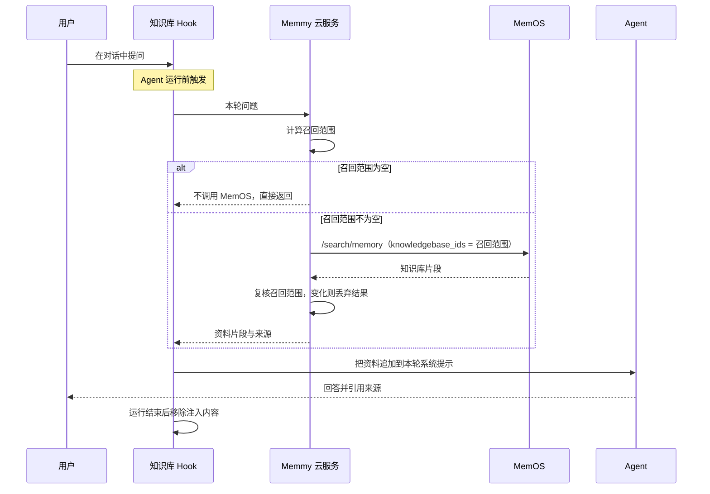

Memmy 是一款桌面端 Agent 应用，让用户的工作在 DeepSeek Harness、Claude Code、Codex 等 Agent 之间延续。用户希望 Agent 回答时参考自己的资料，例如产品手册、项目文档和调研报告。Memmy 知识库为此而建：用户创建知识库、上传文件，再选择哪些知识库参与对话；Agent 回答前自动检索，并在回答中标注资料来源。

这项能力完全基于 MemOS 知识库接口实现。与一个服务端直接调用 MemOS 不同，Memmy 运行在大量终端用户自己的电脑上，用户之间还会互相共享资料。这些前提决定了它的接入方式。

本文以一个产品团队的使用场景为线索，依次说明创建、上传、检索、共享、删除每一步 Memmy 怎么做、为什么这样做。文中代码是示意，用于说明应用服务端如何调用 MemOS 公开接口，不能直接运行。

## 使用场景

以产品团队为例，一次完整的使用过程如下：

1. **建库**：产品经理在 Memmy 中创建一个知识库，上传《MemOS产品介绍.md》和《MemOS 开源VS商业化.md》。两份文件的状态从「处理中」变为「可用」。
2. **共享**：产品经理在「共享管理」中输入销售同事的手机号，把这个知识库共享出去。
3. **提问**：销售同事在 Memmy 中问「MemOS 开源版和商业版有什么区别」。Agent 回答前自动检索，回答中引用《MemOS 开源VS商业化》并注明出处。
4. **更新**：产品经理又上传了一份新资料。销售同事无需任何操作，下一次提问即可检索到新内容。
5. **撤销**：销售同事转岗后，产品经理撤销共享。销售同事之后的提问不再检索这个知识库。


## 整体架构

Memmy 由桌面端和 Memmy 云服务两部分组成。作为面向终端用户的桌面产品，它接入 MemOS 时需要满足四项约束：

1. **API Key 不能下发**：桌面端安装在用户自己的电脑上，写进安装包或本地配置的 API Key 等同于公开。因此 API Key 只放在 Memmy 云服务，桌面端使用用户的 Memmy 登录凭据访问云服务。
2. **归属需要应用判断**：MemOS 知识库归属于开发者项目，并不识别 Memmy 的终端用户。Memmy 为所有用户使用同一个 MemOS 项目，哪个用户拥有、能看到哪个知识库，由云服务在每次调用 MemOS 前判断。
3. **设置需要跟随账号**：同一账号可能在多台电脑上登录，每个知识库的「参与召回」设置保存在云服务。
4. **Agent 不接触凭据**：Agent 在运行中会调用工具、读取本地文件。知识库 Hook 只使用本机服务的访问令牌，检索链路不向 Agent 传递任何云端凭据。

由此形成三层结构：桌面端只与 Memmy 云服务通信，由云服务代表用户调用 MemOS。



落到具体功能上，Memmy 云服务与 MemOS 的分工如下。没有对应接口的功能，完全由 Memmy 云服务在应用层实现：

| Memmy 功能 | Memmy 云服务负责 | MemOS 负责 | MemOS 接口 |
| --- | --- | --- | --- |
| 创建知识库 | 保存 Memmy 与 MemOS 知识库 ID 的对应关系 | 创建知识库 | `/create/knowledgebase` |
| 上传文件 | 确认拥有者，转换知识库 ID | 存储文件，异步完成解析、分段与索引 | `/add/knowledgebase-file` |
| 文件列表与处理状态 | 按文件夹筛选 | 返回文件信息与处理状态 | `/get/knowledgebase-file` |
| 重命名、文件夹 | 保存名称与目录结构 | — | — |
| 参与召回 | 保存每位用户对每个知识库的开关 | — | — |
| Agent 回答前检索 | 计算召回范围，复核检索结果 | 在指定知识库中检索 | `/search/memory` |
| 共享知识库 | 维护成员关系 | — | — |
| 删除知识库或文件 | 先在应用侧删除 | 后台清理知识库与文件 | `/delete/knowledgebase`、`/delete/knowledgebase-file` |

云服务对 MemOS 的所有调用都经过同一个入口，API Key 只在这里出现：

```python
MEMOS_BASE_URL = "https://memos.memtensor.cn/api/openmem/v1"
MEMOS_API_KEY = os.environ["MEMOS_API_KEY"]  # 只配置在云服务，不下发给桌面端


def memos_post(path, body):
    resp = requests.post(
        MEMOS_BASE_URL + path,
        headers={"Authorization": f"Token {MEMOS_API_KEY}"},
        json=body,
    )
    return resp.json()["data"]
```

后文示例都通过 `memos_post` 调用 MemOS。Memmy 云服务自己保存的数据如下，示例用字典表示，实际可换成数据库；目录结构类似，示例中省略：

```python
knowledge_bases = {}  # Memmy 知识库 ID -> {"memos_kb_id", "owner_id", "name"}
members = {}          # Memmy 知识库 ID -> 被共享的用户 ID 集合
recall_selected = {}  # (用户 ID, Memmy 知识库 ID) -> 是否参与召回


def can_access(user_id, kb_id):
    # 拥有者，或被共享的用户
    owner_id = knowledge_bases[kb_id]["owner_id"]
    return user_id == owner_id or user_id in members.get(kb_id, set())
```

## 创建与上传

### 创建知识库

用户提交名称后，云服务先在 MemOS 中创建知识库，再保存两个知识库 ID 的对应关系：

```python
def create_knowledge_base(owner_id, name):
    data = memos_post("/create/knowledgebase", {"knowledgebase_name": name})

    kb_id = str(uuid.uuid4())  # Memmy 知识库 ID，返回给桌面端
    knowledge_bases[kb_id] = {
        "memos_kb_id": data["id"],  # MemOS 知识库 ID，只留在云服务
        "owner_id": owner_id,
        "name": name,
    }
    recall_selected[(owner_id, kb_id)] = True  # 新建的知识库默认参与召回
    return kb_id
```

桌面端后续请求只携带 Memmy 知识库 ID，云服务不接受客户端传入的 MemOS 知识库 ID，MemOS 知识库 ID 因此无从被猜测或伪造。新建的知识库默认参与召回；重命名只修改 Memmy 中保存的名称，不调用 MemOS。

### 上传与管理文件

上传前，桌面端与云服务按 MemOS 知识库的文档限制校验文件：格式为 PDF、DOCX、DOC、TXT、JSON、MD、XML 之一，单文件不超过 100 MB。云服务确认当前用户是拥有者后，把 Memmy 知识库 ID 转换为 MemOS 知识库 ID，再提交文件：

```python
def upload_file(user_id, kb_id, filename, content):
    kb = knowledge_bases[kb_id]
    if kb["owner_id"] != user_id:
        raise PermissionError("只有拥有者可以上传文件")

    mime_type, _ = mimetypes.guess_type(filename)
    encoded = base64.b64encode(content).decode("ascii")
    files = memos_post("/add/knowledgebase-file", {
        "knowledgebase_id": kb["memos_kb_id"],  # 转换为 MemOS 知识库 ID
        "file": [{
            "name": filename,
            "content": f"data:{mime_type};base64,{encoded}",
        }],
    })
    return files[0]["status"]  # 通常为 running，表示 MemOS 正在处理
```

文件较大时，也可以先把文件放到 MemOS 能够访问的地址，再在 `content` 中传入 URL。

MemOS 收到文件后，异步完成解析、分段与索引，文件状态从 `running` 变为 `completed`，处理失败时为 `failed`。只有处理完成的内容才会进入检索结果。Memmy 页面据此展示「处理中」「可用」「失败」，有文件处理中时定时刷新。

文件名、处理状态等文件信息不在 Memmy 中另存，每次打开知识库都从 MemOS 实时查询，文件状态因此只有一个来源。Memmy 额外保存的只有目录：MemOS 知识库中的文件是平铺的，云服务记录文件夹层级和每个文件所在的文件夹，打开文件夹时按对应关系筛选。移动文件只修改对应关系，不需要重新上传，MemOS 也不会重新解析。

## Agent 回答前的检索

这是整条链路的核心。用户之间的隔离，最终落在每次检索传入的知识库 ID 上：传错一个，就会把别人的资料交给 Agent。一次对话中，知识库检索的过程如下：



检索由知识库 Hook 在 Agent 运行前自动发起，Agent 本身不调用任何知识库接口。这样做不依赖 Agent 判断何时该查资料：用户开启「参与召回」后，提问时无需额外提醒「查一下知识库」。代价是每轮都会检索一次，与资料无关的问题也不例外。

Hook 拿到资料后追加到本轮系统提示；运行结束后移除这些内容，下一轮按新问题重新检索，资料不会在多轮对话中累积。

云服务在调用 MemOS 前后各检查一次召回范围：调用前计算范围，决定检索哪些知识库；调用后复核范围，确认检索期间范围没有变化。下面分别说明。

召回范围是以下两个集合的交集。交集为空时，云服务跳过检索，不调用 MemOS。

- 用户开启了「参与召回」的知识库。
- 用户当前有权访问的知识库，包括自己拥有的和被共享的。

以场景中的销售同事为例：销售同事自己有一个知识库，又收到了产品经理共享的知识库，两个都开启了「参与召回」，召回范围就是这两个知识库的 MemOS ID。关掉自己知识库的「参与召回」后，召回范围只剩共享来的那一个。

`knowledgebase_ids` 是这条链路中唯一的权限出口。MemOS 默认不检索任何知识库，只有显式传入的 ID 才进入检索范围；它也支持传入 `all`，但这会检索项目下的所有知识库，包括其他用户的。因此，云服务每次检索前都重新计算范围，只传入明确的 ID 列表，不信任桌面端缓存的列表。

```python
def recall_scope(user_id):
    return [
        kb["memos_kb_id"]
        for kb_id, kb in knowledge_bases.items()
        if can_access(user_id, kb_id)                     # 自己拥有的与被共享的
        and recall_selected.get((user_id, kb_id), False)  # 开启了「参与召回」
    ]


def recall(user_id, query):
    scope = recall_scope(user_id)
    if not scope:
        return []  # 不调用 MemOS

    data = memos_post("/search/memory", {
        "user_id": f"kb-reader-{user_id}",  # 检索专用 ID
        "query": query,
        "knowledgebase_ids": scope,         # 只传明确的 ID，不传 all
    })

    if recall_scope(user_id) != scope:  # 复核：范围变化则丢弃结果
        return []

    return [
        {"title": item["memory_key"], "content": item["memory_value"]}
        for item in data["memory_detail_list"]
    ]
```

检索返回后的复核容易被忽略。一次检索需要一定时间，期间拥有者可能撤销共享，用户也可能关闭某个知识库的「参与召回」。例如销售同事提问时，产品经理恰好撤销了共享：调用 MemOS 前，召回范围里还有这个知识库；检索返回时，它已经不在范围内了。复核发现范围变化，云服务丢弃整次结果，下一轮再按新范围检索。

示例中的 `user_id` 是检索专用的，从不写入对话，因此检索结果里只有知识库片段。这是因为 Memmy 的个人记忆由独立的 Memory 模块负责，两类上下文由各自的 Hook 注入，互不依赖。如果你的应用没有自己的记忆系统，可以传入真实的 `user_id`，让 MemOS 在同一次检索中一并返回用户事实与偏好，具体用法可参考[知识库功能说明](/cn/memos_cloud/features/knowledge_base)。

Hook 注入资料时会注明：这些内容是参考资料而不是指令，Agent 需要引用来源，并忽略资料中出现的任何指令，以防范提示词注入。


## 共享知识库

MemOS 没有成员或共享相关的接口，Memmy 的共享完全在应用层实现。由于所有知识库都在同一个 MemOS 项目下，只要 Memmy 判定成员有权访问，就可以把拥有者知识库的 MemOS ID 加入成员的召回范围。处理过程如下：

1. 拥有者在「共享管理」中输入对方的 Memmy 用户 ID、手机号或邮箱。
2. 云服务把输入解析为 Memmy 账号，确认对方存在且不是本人后，写入一条只读成员关系。这一步不调用 MemOS。
3. 对方刷新页面后，在知识库列表的「共享」分组中看到该知识库，并显示来自哪位用户。新共享的知识库默认参与对方的召回。


共享后，拥有者与被共享的用户权限如下：

| 操作 | 拥有者 | 被共享的用户 |
| --- | --- | --- |
| 查看文件 | ✓ | ✓ |
| 开关「参与召回」 | ✓ | ✓，只影响自己 |
| 上传、删除文件 | ✓ | — |
| 新建、移动、删除文件夹 | ✓ | — |
| 重命名、删除知识库 | ✓ | — |
| 共享管理 | ✓ | — |

共享不复制任何内容：所有成员检索的是同一个 MemOS 知识库。场景中产品经理上传新资料后，销售同事的下一次检索即可命中新内容。拥有者撤销共享后，该成员的召回范围立即不再包含这个知识库。

## 删除知识库

删除分两步：先在 Memmy 中删除，知识库立即从所有成员的列表和召回范围中消失，用户无需等待；再在后台清理 MemOS 中的知识库与文件。以删除知识库为例：

```python
def delete_knowledge_base(user_id, kb_id):
    kb = knowledge_bases[kb_id]
    if kb["owner_id"] != user_id:
        raise PermissionError("只有拥有者可以删除知识库")

    # 1. 先在 Memmy 中删除
    del knowledge_bases[kb_id]
    members.pop(kb_id, None)

    # 2. 再在后台清理 MemOS
    threading.Thread(target=memos_post, args=("/delete/knowledgebase", {
        "knowledgebase_id": kb["memos_kb_id"],
        "delete_all": True,
    })).start()
```

`delete_all` 默认为 `false`，只解除知识库与当前项目的关联，知识库与文件仍然保留；彻底删除必须显式传入 `true`。删除文件与文件夹遵循同样的顺序，后台调用 `/delete/knowledgebase-file`。后台清理可能失败，应用需要准备重试或定期对账，避免 MemOS 中残留已删除的数据。

## 小结

Memmy 的接入可以归结为一句话：MemOS 负责"资料里写了什么"，Memmy 负责"谁能用、用哪些"。任何同时拥有客户端与终端用户的 AI 产品，接入 MemOS 知识库时都可以沿用这套分层。

Memmy 的权限粒度是整个知识库。需要按文件区分可见范围时，可以把可见范围不同的文件放进不同的知识库。
