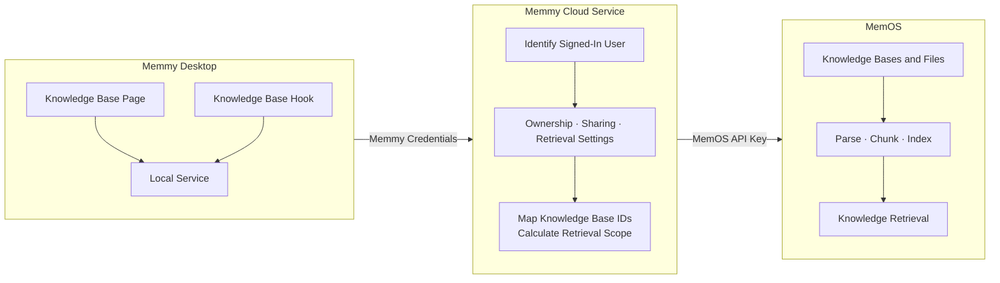
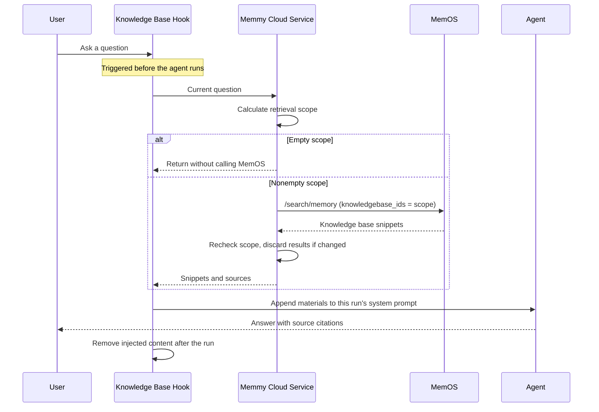

Memmy is a desktop agent application that helps users continue work across DeepSeek Harness, Claude Code, Codex, and other agents. Users want agents to consult their own product manuals, project documents, and research reports. Memmy's knowledge bases serve this need: users create libraries, upload files, and select which libraries participate in conversations. Before an agent answers, retrieval runs automatically, and the answer cites its sources.

This feature is built entirely on MemOS knowledge base APIs. Unlike a server that calls MemOS directly, Memmy runs on many end users' computers and lets users share materials with each other. These conditions shape its integration.

This article follows a product team's workflow through creation, upload, retrieval, sharing, and deletion, explaining what Memmy does at each step and why. Code snippets illustrate application-server calls to public MemOS APIs; they are not a directly runnable application.

## Usage scenario

A product team follows this workflow:

1. **Create.** A product manager creates a Memmy knowledge base and uploads *MemOS Product Overview.md* and *MemOS Open Source vs Commercial.md*. Both files move from Processing to Ready.
2. **Share.** The manager enters a sales colleague's phone number in Sharing to share the library.
3. **Ask.** The colleague asks “How do MemOS Open Source and commercial editions differ?” Before answering, the agent automatically retrieves information, then cites *MemOS Open Source vs Commercial*.
4. **Update.** The manager uploads another document. The colleague's next question can retrieve it without extra action.
5. **Revoke.** After the colleague changes roles, the manager revokes sharing. Subsequent questions no longer search this library.

*The interface images in this guide are localized illustrations of the Chinese UI.*


## Architecture

Memmy consists of a desktop app and a cloud service. Integration has four constraints:

1. **Keep the API key on the server.** Desktop packages and local settings are accessible on users' computers. The MemOS API key stays in Memmy's cloud service; the desktop app authenticates to that service using the user's Memmy credentials.
2. **Determine ownership in the application.** MemOS knowledge bases belong to a developer project and do not identify Memmy end users. Memmy uses one MemOS project for all users. Before each call, its cloud service determines which user owns or can access each library.
3. **Keep settings with the account.** A user may sign in on multiple computers. Each user's Include in Retrieval setting for each library is stored in the cloud service.
4. **Keep cloud credentials away from the agent.** Agents call tools and read local files. The knowledge base hook uses only a local-service access token; the retrieval path does not pass cloud credentials to the agent.

The result is three layers: the desktop communicates with Memmy's cloud service, which calls MemOS on the user's behalf.



The responsibilities for each feature are as follows. Features without a corresponding MemOS API are implemented entirely in Memmy's application layer.

| Memmy feature | Memmy cloud service | MemOS | MemOS API |
| --- | --- | --- | --- |
| Create a knowledge base | Store the mapping between Memmy and MemOS knowledge base IDs | Create the knowledge base | `/create/knowledgebase` |
| Upload files | Verify ownership and map the knowledge base ID | Store files and asynchronously parse, chunk, and index them | `/add/knowledgebase-file` |
| File list and processing status | Filter by folder | Return file details and processing status | `/get/knowledgebase-file` |
| Rename and folders | Store names and directory structure | — | — |
| Include in Retrieval | Store each user's switch for each library | — | — |
| Search before an agent answers | Calculate scope and recheck results | Search selected knowledge bases | `/search/memory` |
| Share a knowledge base | Maintain memberships | — | — |
| Delete a library or file | Remove it from the application first | Clean up libraries and files in the background | `/delete/knowledgebase`, `/delete/knowledgebase-file` |

All MemOS calls pass through one entry point. The API key appears only here:

```python
MEMOS_BASE_URL = "https://memos.memtensor.cn/api/openmem/v1"
MEMOS_API_KEY = os.environ["MEMOS_API_KEY"]  # Configure only in the cloud service


def memos_post(path, body):
    resp = requests.post(
        MEMOS_BASE_URL + path,
        headers={"Authorization": f"Token {MEMOS_API_KEY}"},
        json=body,
    )
    return resp.json()["data"]
```

The remaining examples call MemOS through `memos_post`. Memmy's own data is represented with dictionaries below; a real implementation can use a database. Folder data follows a similar structure and is omitted.

```python
knowledge_bases = {}  # Memmy KB ID -> {"memos_kb_id", "owner_id", "name"}
members = {}          # Memmy KB ID -> set of recipient user IDs
recall_selected = {}  # (user ID, Memmy KB ID) -> included in retrieval


def can_access(user_id, kb_id):
    # The owner or a recipient
    owner_id = knowledge_bases[kb_id]["owner_id"]
    return user_id == owner_id or user_id in members.get(kb_id, set())
```

## Create and upload

### Create a knowledge base

When a user submits a name, the cloud service creates the MemOS knowledge base, then stores the ID mapping:

```python
def create_knowledge_base(owner_id, name):
    data = memos_post("/create/knowledgebase", {"knowledgebase_name": name})

    kb_id = str(uuid.uuid4())  # Memmy KB ID returned to the desktop app
    knowledge_bases[kb_id] = {
        "memos_kb_id": data["id"],  # MemOS KB ID stays in the cloud service
        "owner_id": owner_id,
        "name": name,
    }
    recall_selected[(owner_id, kb_id)] = True  # Included by default
    return kb_id
```

Subsequent desktop requests carry only the Memmy knowledge base ID. The cloud service does not accept client-supplied MemOS knowledge base IDs, keeping them outside client-controlled input. New libraries are included in retrieval by default. Renaming changes only the name stored in Memmy and makes no MemOS call.

### Upload and manage files

Before upload, the desktop and cloud service validate files against MemOS limits: PDF, DOCX, DOC, TXT, JSON, MD, or XML, with a maximum of 100 MB per file. After confirming that the caller is the owner, the service maps the Memmy ID to the MemOS ID and submits the file:

```python
def upload_file(user_id, kb_id, filename, content):
    kb = knowledge_bases[kb_id]
    if kb["owner_id"] != user_id:
        raise PermissionError("Only the owner can upload files")

    mime_type, _ = mimetypes.guess_type(filename)
    encoded = base64.b64encode(content).decode("ascii")
    files = memos_post("/add/knowledgebase-file", {
        "knowledgebase_id": kb["memos_kb_id"],  # Map to the MemOS KB ID
        "file": [{
            "name": filename,
            "content": f"data:{mime_type};base64,{encoded}",
        }],
    })
    return files[0]["status"]  # Usually running while MemOS processes the file
```

For larger files, place the file at an address MemOS can access and pass the URL in `content`.

MemOS asynchronously parses, chunks, and indexes the file. Status moves from `running` to `completed`, or to `failed` on failure. Only completed content enters retrieval results. Memmy displays Processing, Ready, or Failed, refreshing periodically while files are processing.

Memmy does not duplicate filenames, processing status, or other file details: opening a library queries MemOS directly, providing one status source. Memmy stores only the additional directory structure. MemOS knowledge base files are flat; the cloud service records folder hierarchy and each file's folder, then filters accordingly. Moving a file changes the mapping without uploading or parsing it again.

## Retrieval before the agent answers

User isolation ultimately depends on the knowledge base IDs submitted for every search. An incorrect ID can expose another user's materials. The flow is:



The hook automatically retrieves before the agent runs; the agent calls no knowledge base APIs itself. After Include in Retrieval is enabled, users do not need to request a search explicitly. The trade-off is one search per turn, including questions unrelated to the materials.

The hook appends materials to the current run's system prompt, then removes them when the run ends. Each new question triggers fresh retrieval, so materials do not accumulate over multiple turns.

The cloud service checks scope before and after the MemOS call: first to select libraries, then to confirm that access did not change during retrieval.

The retrieval scope is the intersection of:

- Libraries the user has enabled for retrieval.
- Libraries the user can currently access, including owned and shared libraries.

With an empty intersection, the service skips the MemOS call. In the example, if the colleague owns one library and receives the manager's shared library, both enabled, the scope contains both MemOS IDs. Disabling retrieval for the personal library leaves only the shared one.

`knowledgebase_ids` is the final permission boundary in this path. MemOS searches no knowledge base by default; only explicitly supplied IDs enter scope. It also accepts `all`, which searches every library in the project, including other users' libraries. Memmy recomputes scope on every search, supplies an explicit ID list, and derives it from server-side state.

```python
def recall_scope(user_id):
    return [
        kb["memos_kb_id"]
        for kb_id, kb in knowledge_bases.items()
        if can_access(user_id, kb_id)                     # Owned and shared
        and recall_selected.get((user_id, kb_id), False)  # Retrieval enabled
    ]


def recall(user_id, query):
    scope = recall_scope(user_id)
    if not scope:
        return []  # Skip MemOS

    data = memos_post("/search/memory", {
        "user_id": f"kb-reader-{user_id}",  # Retrieval-only identifier
        "query": query,
        "knowledgebase_ids": scope,         # Explicit IDs, never all
    })

    if recall_scope(user_id) != scope:  # Discard results if scope changed
        return []

    return [
        {"title": item["memory_key"], "content": item["memory_value"]}
        for item in data["memory_detail_list"]
    ]
```

The second check is easy to overlook. Retrieval takes time, during which an owner may revoke sharing or a user may disable a library. If the manager revokes access while the colleague's request is running, the library is authorized before the MemOS call but no longer authorized when results return. The service discards the entire result; the next turn uses the new scope.

The example's `user_id` is reserved for retrieval and never receives conversation writes, so results contain only knowledge base snippets. Memmy's personal memory is handled by a separate Memory module; each context type has its own hook. Applications without a separate memory system can pass the real `user_id` to retrieve user facts and preferences in the same search. See [knowledge base features](/memos_cloud/features/knowledge_base).

The hook labels retrieved content as reference material, asks the agent to cite sources, and tells it to ignore instructions contained in the materials to reduce prompt-injection risk.


## Share a knowledge base

MemOS has no membership or sharing API. Memmy implements sharing in the application layer. Because all libraries belong to one MemOS project, the service can add an owner's MemOS knowledge base ID to a recipient's retrieval scope once access is authorized.

1. The owner enters a Memmy user ID, phone number, or email in Sharing.
2. The cloud service resolves it to a Memmy account, verifies that it exists and is not the owner, and stores a read-only membership. No MemOS call is made.
3. After refreshing, the recipient sees the library under Shared, with its owner's name. New shared libraries are included in the recipient's retrieval by default.


| Operation | Owner | Recipient |
| --- | --- | --- |
| View files | Yes | Yes |
| Toggle Include in Retrieval | Yes | Yes, for their own account only |
| Upload or delete files | Yes | — |
| Create, move, or delete folders | Yes | — |
| Rename or delete the knowledge base | Yes | — |
| Manage sharing | Yes | — |

Sharing creates no content copies: all members search the same MemOS knowledge base. A newly uploaded document can appear in the colleague's next search once available. Revoking sharing immediately removes the library from that member's retrieval scope.

## Delete a knowledge base

Deletion has two stages. First remove the library from Memmy so it immediately disappears from members' lists and retrieval scopes. Then clean up MemOS data in the background.

```python
def delete_knowledge_base(user_id, kb_id):
    kb = knowledge_bases[kb_id]
    if kb["owner_id"] != user_id:
        raise PermissionError("Only the owner can delete a knowledge base")

    # 1. Remove from Memmy first
    del knowledge_bases[kb_id]
    members.pop(kb_id, None)

    # 2. Clean up MemOS in the background
    threading.Thread(target=memos_post, args=("/delete/knowledgebase", {
        "knowledgebase_id": kb["memos_kb_id"],
        "delete_all": True,
    })).start()
```

`delete_all` defaults to `false`, which unlinks the knowledge base from the current project while retaining the library and files. Complete deletion requires explicit `true`. Files and folders follow the same sequence, using `/delete/knowledgebase-file` in the background. Prepare retries or periodic reconciliation for failed cleanup so deleted application data does not remain in MemOS.

## Summary

MemOS handles what the documents say; Memmy handles who can use them and which ones are in scope. AI products with clients and end users can follow the same division when integrating MemOS knowledge bases.

Memmy permissions apply to the whole knowledge base. For file-level visibility differences, place files with different audiences into separate libraries.
